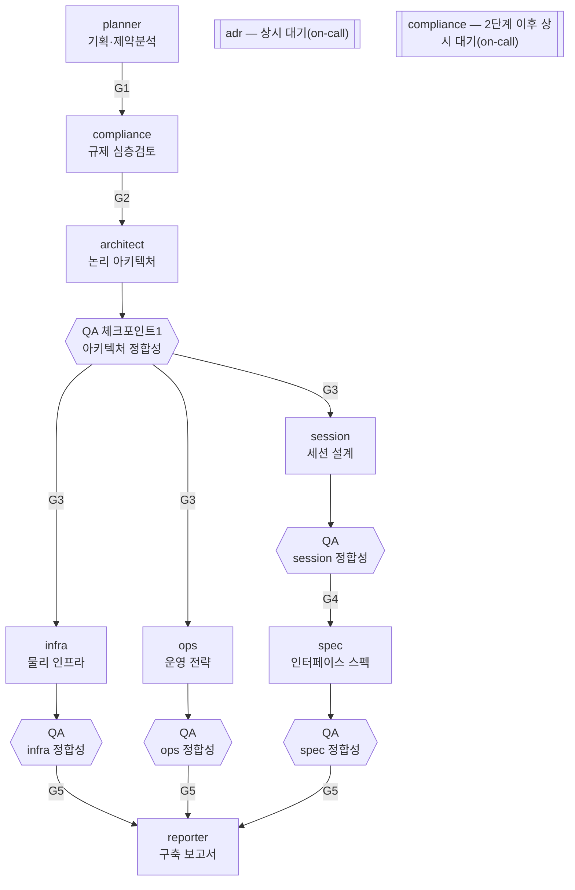

# payment-launch-orchestrator

[](LICENSE)
[](.claude-plugin/plugin.json)

> 신규 결제/PG(Payment Gateway, 결제대행사) 서비스 출시를 기획부터 구축 보고서까지, **10명의 AI 에이전트**가 팀으로 자동화하는 [Claude Code](https://claude.com/claude-code) 하네스입니다.

기획(킥오프·제약분석) → 규제 준수 심층 검토 → 논리 아키텍처 설계(QA 게이트) → (물리 인프라 설계 ∥ 트랜잭션 세션설계 ∥ 운영전략, 각각 완료 직후 QA 게이트) → 인터페이스 스펙(QA 게이트) → 구축 보고서까지, 결제 서비스 하나를 출시 준비하는 데 필요한 **설계 문서 세트**를 한 번에 만듭니다. (QA 게이트는 architect 이후 5개 체크포인트에 적용되며, 그 앞의 기획·규제 심층 검토 단계에는 별도 게이트가 없습니다.)

> **웹에서 더 편하게 보고 싶다면** → 이 저장소의 [소개 페이지](https://seokrae.github.io/payment-orchestrator/)에서 같은 내용을 다이어그램과 함께 볼 수 있습니다.

## 시작 전에 알아두면 좋은 것

- **설계 문서만 만듭니다** — 실제 코드 구현과 그 코드가 스펙대로 동작하는지 확인하는 "개발 QA"는 범위 밖입니다([설계 범위](#설계-범위--문서-qa와-개발-qa) 참조). 산출물은 완성본이 아니라 곳곳에 (미결)·(미확인)·(미확보) 표기가 남은 초안이며, 사람의 최종 확인이 필요합니다.
- 규제 체크리스트(`compliance-review`)는 **한국 법제 기준**(전자금융거래법·특정금융정보법 등, 리서치 시점 기준)입니다 — 해외 연동 시나리오도 다루지만 판단 근거 법령 자체는 한국 기준입니다.
- **처음 실행할 땐 가볍지 않습니다** — 신규 서비스로 `launch-orchestrator`를 트리거하면 "맛보기" 단계 없이 10명 전원이 곧바로 스폰되는 전체 파이프라인이 그대로 실행됩니다. 정상 흐름 기준 에이전트 호출 약 22~24회 안팎(QA 재검증 왕복이 늘면 그 이상), 수십 분~여러 시간 규모로 예상하세요. 가볍게 먼저 확인해보고 싶다면 전체 팀 대신 `compliance-review`나 `qa-review`를 단독으로 트리거할 수 있습니다. (이미 만든 서비스에 대한 "제약분석만 다시" 같은 **후속 요청은 예외**입니다 — 영향받는 팀원 1명만 재소집되므로 훨씬 가볍습니다. [후속 작업](#후속-작업) 참조.)
- **실행 도중 최대 3번, 리더가 직접 확인 질문을 드립니다**(사용자 확인 왕복) — 시작 직후 구조를 바꿀 만한 질문 몇 개(역인터뷰), 아키텍처가 갈릴 때 옵션 선택, 보고서 확정 전 핵심 결정 확인. 모두 게이트가 아니라 선택적 보강이라 답하지 않아도(스킵/무응답) 정해진 기본값으로 자동 진행됩니다.

> 원본은 개인 Obsidian PARA vault에서 `harness:harness` 메타 스킬로 반복 확장하며 만들어졌습니다 — 규제 전문가 분리, 인프라/어플리케이션 역할 분리, 점진적 QA 게이트 순서로 4단계에 걸쳐 진화했습니다. 이 저장소는 그 결과물을 독립적으로 재사용할 수 있게 옮긴 것입니다.

## 목차

- [파이프라인 한눈에 보기](#파이프라인-한눈에-보기)
- [팀 구성](#팀-구성)
- [스킬 3개](#스킬-3개)
- [사용법](#사용법)
- [전제 조건](#전제-조건)
- [내 프로젝트로 이식하기](#내-프로젝트로-이식하기)
- [설계 범위 — "문서 QA"와 "개발 QA"](#설계-범위--문서-qa와-개발-qa)
- [설계 원칙](#설계-원칙)
- [에이전트 상세](#에이전트-상세)
- [라이선스](#라이선스)

## 파이프라인 한눈에 보기



의존 관계를 텍스트로 요약하면: `planner` → `compliance` → `architect` → **QA** → (`infra` ∥ `session` ∥ `ops`) → **QA(각각)** → `spec`(session QA 통과 후) → **QA** → `reporter`(3개 QA 통과 후). `adr`·`compliance`(2단계 이후)는 고정 순서 없이 전 팀원의 SendMessage 요청에 상시 응답합니다.

## 팀 구성

| 에이전트 | 역할 | 산출물 |
|---|---|---|
| [`payment-planner`](agents/payment-planner.md) | 킥오프(사업배경·이해관계자) + 제약분석(H/M/L 등급) | `docs/kickoff/`, `docs/constraints/` |
| [`payment-compliance-analyst`](agents/payment-compliance-analyst.md) | 규제 준수 심층 검토(전자금융거래법·PCI-DSS·개인정보보호법·특금법·해외연동) 1회 + 상시 대기 | `docs/constraints/` (02번 보강) |
| [`payment-architect`](agents/payment-architect.md) | 논리 컴포넌트 아키텍처 설계 (경계·인증/승인/정산 흐름, 구조가 갈리면 옵션 제시 후 확정) | `docs/architecture/01-*` |
| [`payment-infra-builder`](agents/payment-infra-builder.md) | 아키텍처의 네트워크 인프라 레벨 문서화 (서버 사이징·이중화·존·DR) — 바로 구축에 쓸 수 있는 기준 문서 | `docs/architecture/02-{service-slug}-인프라-사이징.md` |
| [`payment-session-designer`](agents/payment-session-designer.md) | 트랜잭션 세션 시나리오 설계 (승인·취소·구독·가상계좌·웹훅 등) | `docs/session-design/` |
| [`payment-ops-designer`](agents/payment-ops-designer.md) | 정산·모니터링·이슈대응·테스트 전략 | `docs/operations/` |
| [`payment-spec-writer`](agents/payment-spec-writer.md) | 인터페이스·API 스펙 | `docs/specs/` |
| [`payment-launch-qa`](agents/payment-launch-qa.md) | 생산자 완료 직후 경계면 교차검증(생성-검증 게이트), 불일치는 즉시 되돌려보냄(무진행 감지까지 반복) | `{service-root}/_launch-workspace/qa/` (문서 산출물 아님) |
| [`payment-decision-recorder`](agents/payment-decision-recorder.md) | 되돌리기 어려운 결정을 ADR로 기록, 상시 대기 | `docs/adr/` |
| [`payment-launch-reporter`](agents/payment-launch-reporter.md) | 전 팀원 산출물 + QA 결과를 구축 보고서로 종합, 핵심 결정 확인 후 확정 | `docs/reports/` |

오케스트레이터는 [`skills/launch-orchestrator/SKILL.md`](skills/launch-orchestrator/SKILL.md) 하나입니다. 팀 구성·착수 게이트(G1~G5)·에러 핸들링을 정의하며, 리더 역할은 별도 에이전트 없이 세션 자체가 맡습니다.

### 스킬 3개

| 스킬 | 트리거 문구 예시 | 역할 |
|---|---|---|
| [`launch-orchestrator`](skills/launch-orchestrator/SKILL.md) | "신규 결제 서비스 출시", "PG 서비스 구축 하네스" | 팀 전체를 조율하는 메인 스킬. 착수 게이트 G1~G5가 열릴 때마다 해당 팀원을 스폰하고 `gates.md`에 판정을 남기며, 부분 재실행(특정 팀원만 재작업)도 처리 |
| [`compliance-review`](skills/compliance-review/SKILL.md) | "규제 검토", "PG 등록 대상인지 확인", "PCI-DSS 대응해야 하나" | 전자금융거래법(국내 PG·전자결제 등록/인허가 근거법) 등록/인허가·PCI-DSS(카드 데이터 보안 국제표준)·개인정보보호법(국외이전)·특정금융정보법(특금법, AML/가상자산사업자(VASP) 규제)·해외 PSP(결제서비스제공자) 연동(외국환거래법·GDPR) 5개 규제 도메인 체크리스트로 H/M/L 등급 판정. `references/regulatory-checklist.md`에 77개 항목이 확인 상태(✅/⚠️/❓)와 함께 정리돼 있습니다. **법률 자문이 아닙니다.** |
| [`qa-review`](skills/qa-review/SKILL.md) | "설계 문서 정합성 검증", "이 문서들 앞뒤가 맞나 확인", "QA 해줘" | 설계 문서 간 경계면 교차검증(PASS/FIX/GAP 판정). **"문서 QA"만 다룹니다** — 실제 구현 코드가 스펙대로 동작하는지 확인하는 "개발 QA"는 범위 밖입니다([설계 범위](#설계-범위--문서-qa와-개발-qa) 참조). |

`compliance-review`·`qa-review` 2개는 팀 전체를 돌리지 않고 단독으로도 쓸 수 있습니다 — 오케스트레이터 안에서 각각 compliance·qa 팀원이 내부적으로 호출하는 것과 동일한 스킬입니다. `launch-orchestrator`는 그 자체가 오케스트레이터라 "단독 실행"이라는 구분이 의미가 없습니다.

## 사용법

1. 설치 — 상황에 맞게 고르세요:
   - **플러그인으로 설치** (여러 프로젝트에서 반복 재사용할 계획이면 이쪽을 권장): `.claude-plugin/plugin.json`·`marketplace.json`이 모두 포함돼 있어 아래 두 방법 다 됩니다. 플러그인 이름은 `payments`이며, 설치되면 스킬은 `payments:launch-orchestrator` 형태로 노출됩니다.
     - marketplace 등록: `claude plugin marketplace add <이 저장소 경로 또는 git URL>` 후 `claude plugin install payments@sr` (마켓플레이스 이름은 `sr` — 실사용 검증 완료: `claude plugin details payments@sr`로 스킬 3개·에이전트 10개 정상 인식 확인됨)
     - 또는 등록 없이 바로 로드: `claude --plugin-dir <이 저장소 경로>`
   - **디렉터리 복사** (지금 이 프로젝트 하나에서만 빠르게 써보려면 이쪽이 더 간단합니다): 이 저장소의 `agents/`·`skills/` 안의 파일들을 대상 프로젝트의 `.claude/agents/`·`.claude/skills/`로 복사합니다(marketplace 등록 없이 즉시 사용 가능, 이식 방법은 [내 프로젝트로 이식하기](#내-프로젝트로-이식하기) 참조).
2. 세션에 입력합니다:
   ```
   새 결제 서비스 'xyz-pay' 출시 준비 문서 만들어줘 — 해외 카드사 다이렉트 연동, Q3 목표
   ```
   요구사항 정의서 같은 노트/문서가 이미 있다면 경로를 함께 알려줘도 됩니다:
   ```
   새 결제 서비스 'xyz-pay' 출시 준비 문서 만들어줘 — 요구사항 정의서는 이 경로 참고: {파일 경로}
   ```
   노트는 마크다운·텍스트·PDF 형식을 지원합니다(Read 도구 기본 지원 범위 — 그 외 형식은 텍스트 붙여넣기나 변환을 요청받습니다). `payment-planner`가 노트 내용을 킥오프 문서 표준 필드에 매핑하고, 근거를 찾을 수 없는 부분은 "(미결)"로 남긴 `## 노트 반영 현황` 갭 분석 표를 함께 남깁니다.
3. `launch-orchestrator` 스킬이 트리거되어 10명 팀이 자동으로 조율하며 작업합니다.
4. 결과는 `{service-root}`(문서 저장 위치 — 최초 실행 시 하네스가 직접 물어보며 정합니다. 자세한 내용은 [전제 조건](#전제-조건) 참조)`/docs/{kickoff,constraints,architecture,session-design,operations,specs,adr,reports}/`에 생성됩니다.

### 후속 작업

이미 만든 서비스에 대해 "제약분석만 다시", "아키텍처 수정해줘" 같은 요청도 같은 스킬이 처리합니다 — 영향받는 팀원만 골라 재실행합니다(전체 팀 재소집 아님). 자세한 절차는 오케스트레이터 스킬의 "Phase 0: 컨텍스트 확인" 참조.

## 전제 조건

이 하네스는 문서를 어디에 둘지 **특정 폴더 구조를 강제하지 않습니다.** 오케스트레이터 Phase 0가 실행 시점에 `{service-root}`(문서 루트 경로)를 프로젝트에 이미 있는 컨벤션에서 찾거나, 없으면 사용자에게 직접 물어서 정합니다.

**실행 환경**: Claude Code 세션에 `Agent` 도구(`name` 파라미터)와 `SendMessage`가 있어야 합니다. 작업 목록 도구(`TaskCreate` 등)는 필요 없어요. 리더가 게이트를 직접 판정하고 그 시점에 팀원을 스폰하며, 판정 이력은 `{service-root}/_launch-workspace/gates.md`에 남습니다.

**외부 플러그인·노트 앱에 전혀 의존하지 않습니다.** Obsidian이 설치돼 있을 필요도, 다른 노트 도구가 있을 필요도 없습니다 — 문서 구조는 `docs/{kickoff,constraints,architecture,session-design,operations,specs,adr,reports}/` 표준 폴더와 각 문서 최상단의 `# 제목` 헤더, 표준 마크다운만으로 하네스 자체가 자기완결적으로 구성합니다. 특수 프론트매터 필드나 wiki-link(`[[...]]`) 문법도 쓰지 않습니다 — 일반 마크다운 뷰어·에디터 어디서나 그대로 읽힙니다. `reporter`가 마지막에 쓰는 구축 보고서(`docs/reports/{service-slug}-플랫폼-구축-보고서.md`)가 전체 산출물로 가는 단일 진입점(목차) 역할을 합니다.

## 내 프로젝트로 이식하기

1. `agents/payment-*.md` 10개를 대상 프로젝트의 `.claude/agents/`로, `skills/{launch-orchestrator,compliance-review,qa-review}/` 3개 디렉터리를 대상 프로젝트의 `.claude/skills/`로 복사합니다(Claude Code는 프로젝트 로컬 에이전트·스킬을 `.claude/agents/`·`.claude/skills/`에서 찾으므로, 복사할 때 이 경로로 넣어야 합니다).
2. 문서 루트(`{service-root}`)는 Phase 0에서 실행 시점에 물어보므로 파일을 미리 고칠 필요는 없습니다 — 다만 항상 같은 위치를 쓰고 싶다면 각 에이전트 파일의 `{service-root}` 표기를 고정 경로로 바꿔도 됩니다.
3. `compliance-review`의 체크리스트는 **한국 결제 규제 기준**(2026-08-01 리서치 시점)입니다 — 해외 시장·다른 업종이면 `references/regulatory-checklist.md` 자체를 새로 조사해 교체해야 합니다.
4. `CLAUDE.md`에 하네스 포인터를 프로젝트 컨벤션에 맞춰 추가합니다(이 저장소의 `CLAUDE.md` 형식 참고).

## 설계 범위 — "문서 QA"와 "개발 QA"

이 하네스는 **설계 문서만** 다룹니다. `payment-launch-qa`가 하는 검증은 "세션설계 시나리오가 스펙에 API로 다 옮겨졌나" 같은 문서 대 문서 정합성이며, **실제로 구현된 코드가 그 스펙대로 동작하는지는 확인하지 않습니다** — 코드는 이 저장소 밖의 별도 코드베이스에 있고, 그건 별도의 개발+QA 하네스가 필요한 영역입니다. `payment-ops-designer`가 만드는 "테스트 전략" 문서가 그 다음 단계(개발 QA)로 넘어가는 핸드오프 산출물 역할을 하도록 설계돼 있습니다.

## 설계 원칙

- **생산자와 검증자를 분리한다** — `payment-launch-qa`는 문서를 만들지 않고 교차검증만 합니다. 스스로 만든 문서를 스스로 검증하면 놓치는 게 그대로 남습니다.
- **점진적 QA** — 전체 완성 후 한 번에 몰아서 검증하지 않고, 각 생산자가 끝나는 즉시 바로 확인합니다. 문제를 일찍 잡을수록 되돌리는 비용이 작습니다.
- **재시도는 진행이 있는 한 계속한다** — QA 재검증은 고정 횟수 상한이 아니라 무진행 감지로 종료 시점을 정합니다. 항목 단위로는 그 항목에 이미 한 번 나왔던 것과 동일한 지적이 다시 등장하면(직전 라운드가 아니어도 해당) 그 항목만, 체크포인트 단위로는 남은 불일치 항목 수가 2라운드 연속 나아지지 않으면 전체를 무진행으로 봅니다. "충분히 구체화됐다"는 판정을 횟수보다 우선하되, 더 이상 나아지지 않는 지점에서는 강제 통과 처리 후 미결로 남깁니다. 무한 루프보다 "사람이 확인할 목록"을 남기는 쪽을 택합니다.
- **역할이 다르면 에이전트를 분리한다** — 인프라 구축(물리·실행형)과 어플리케이션 설계(논리·문서형)는 성격이 다르다는 판단으로 별도 에이전트로 나눴습니다. 규제·정책 판단도 마찬가지로 전문화했습니다.
- **스킬(어떻게)과 에이전트(누가)를 분리한다** — 규제 판단 로직(`compliance-review`)과 QA 판정 로직(`qa-review`)은 독립 스킬로 빼서, 팀 밖에서 단독으로도 쓸 수 있게 했습니다.
- **사용자 확인 왕복은 게이트가 아니다** — 역인터뷰·아키텍처 옵션 제시·핵심 결정 확인 3곳 모두 리더가 사용자에게 직접 묻지만, 착수 순서를 강제하는 게이트(G1~G5)와는 성격이 다릅니다. 답하지 않아도 미리 정해둔 기본값으로 자동 진행되어 파이프라인을 막지 않습니다.

## 에이전트 상세

에이전트와 스킬은 역할이 다릅니다 — **에이전트는 "누가 하는가"** (역할·권한이 고정된 팀원, `Agent` 도구로 스폰하면 독립된 컨텍스트에서 작업), **스킬은 "어떻게 하는가"** (여러 호출자가 공유해 꺼내 쓰는 절차서, 현재 컨텍스트에 지침만 로드). 각 에이전트 정의 파일(`agents/*.md`) 자체가 그 역할 전용 업무 매뉴얼이며, 그중 규제 판정(`compliance-review`)과 QA 판정(`qa-review`) 두 절차만 팀 밖에서도 재사용 가치가 있다고 보고 별도 스킬로 분리했습니다. 아래는 10개 에이전트 각각의 요약이며(항목을 눌러 펼치세요), 팀 통신 프로토콜·에러 핸들링 전체는 링크한 원본 파일을 참고하세요.

<details>
<summary><strong>1. <a href="agents/payment-planner.md"><code>payment-planner</code></a> — 기획·제약분석</strong></summary>

- **착수 조건**: 없음 — 팀의 시작점
- **핵심 역할**: 사업 배경·목표·이해관계자 킥오프 문서 + H/M/L 등급 제약분석. 요구사항 정의서 등 노트가 제공되면 표준 필드에 매핑하고 `## 노트 반영 현황` 갭 분석 표를 남김
- **핵심 원칙**: 착수 차단급(H) 제약을 최우선 표면화, 심층 규제 판단은 compliance에 위임, 미확인 값은 추정하지 않고 "(미결)" 표기(노트 매핑도 동일 원칙)
- **입력 → 출력**: 사용자 제공 서비스 개요 또는 노트/문서 원문(마크다운·텍스트·PDF) → `docs/kickoff/`, `docs/constraints/01-*`
- **주요 협업**: 완료 즉시 H급 제약·확정 스코프를 compliance에 SendMessage 전달(G1 구현)

</details>

<details>
<summary><strong>2. <a href="agents/payment-compliance-analyst.md"><code>payment-compliance-analyst</code></a> — 규제 준수 심층 검토</strong></summary>

- **착수 조건**: G1 — planner의 킥오프+제약분석 완료
- **핵심 역할**: 5개 규제 도메인(전자금융거래법·PCI-DSS·개인정보보호법·특금법·해외연동) 심층 검토 1회, 이후 전 팀원 규제 질의에 상시 대기
- **핵심 원칙**: 법률 자문 아님 caveat 명시, `compliance-review` 스킬 체크리스트만 근거로 판정(자체 지식으로 새 규제 판단 생성 금지)
- **입력 → 출력**: `docs/constraints/01-*` → `docs/constraints/02-*`(H급 규제 항목·법무 확인 필요 목록 포함)
- **주요 협업**: 완료 시 H급 규제 항목을 architect에 전달(G2 구현 — 이 팀의 핵심 안전장치)

</details>

<details>
<summary><strong>3. <a href="agents/payment-architect.md"><code>payment-architect</code></a> — 논리 컴포넌트 아키텍처</strong></summary>

- **착수 조건**: G2 — compliance 산출물에 "법무 확인 필요 목록" 섹션 존재
- **핵심 역할**: 논리 컴포넌트 구조 + 컴포넌트 간 통신 방향(호출 방향·동기/비동기) 정의. 물리 인프라는 다루지 않음. 구조가 하류 4개 기준 중 2개 이상에서 의미 있게 갈리면 확정 전 사용자에게 옵션을 제시(사용자 확인 왕복 UC2 — `payment-architect.md`의 "아키텍처 옵션 제시(UC2)" 절 참조)
- **핵심 원칙**: 경계는 기본값으로 트랜잭션 상태 전이 기준을 따르되 절대 규칙은 아님(도메인 단위 묶기도 옵션화 가능), 구체적 엔드포인트 시그니처는 확정하지 않고 spec에 기준선만 넘김
- **입력 → 출력**: `docs/constraints/`(제약+규제) → `docs/architecture/01-*`
- **주요 협업**: 옵션 제시가 있었다면 왕복 종료 후, 없었다면 설계 완료 즉시 infra·session·ops 3명에게 동시 SendMessage(팬아웃 트리거)

</details>

<details>
<summary><strong>4. <a href="agents/payment-infra-builder.md"><code>payment-infra-builder</code></a> — 물리 인프라 설계</strong></summary>

- **착수 조건**: G3 — QA 체크포인트1(아키텍처 정합성) 완결, session·ops와 3갈래 병렬
- **핵심 역할**: 서버 사이징·이중화·존 구성·DR을 "바로 구축에 쓰는 단일 기준 문서"로 관리(설계와 실행을 분리하지 않음)
- **핵심 원칙**: 이중화는 기본값이 아니라 결정 사항(미확정이면 ADR 요청), 트래픽 근거 없이 서버 대수를 지어내지 않음
- **입력 → 출력**: architect 컴포넌트 구조 + compliance DR/이중화 규제 판정 → `docs/architecture/02-*`
- **주요 협업**: ops와 서버 존 구성 ↔ 운영 전환 일정 상호 확인

</details>

<details>
<summary><strong>5. <a href="agents/payment-session-designer.md"><code>payment-session-designer</code></a> — 트랜잭션 세션 설계</strong></summary>

- **착수 조건**: G3, infra·ops와 3갈래 병렬
- **핵심 역할**: 승인·취소·구독·가상계좌·웹훅 등 시나리오별 요청-응답 시퀀스 + 예외 흐름 설계
- **핵심 원칙**: 정상 흐름만 그리지 않음(타임아웃·중복요청·웹훅유실 등 예외 필수 포함), architect 경계 밖 컴포넌트를 임의로 추가하지 않음
- **입력 → 출력**: `docs/architecture/` → `docs/session-design/`
- **주요 협업**: spec의 직접 상류(하드 의존) — 이 팀원의 QA 통과가 G4(spec 착수)의 조건

</details>

<details>
<summary><strong>6. <a href="agents/payment-ops-designer.md"><code>payment-ops-designer</code></a> — 운영·정산·테스트 전략</strong></summary>

- **착수 조건**: G3, infra·session과 3갈래 병렬
- **핵심 역할**: 정산 전략·모니터링/알람·이슈대응 프로세스·테스트 전략·운영 전환 로드맵
- **핵심 원칙**: 정산 정합성은 "승인 건수=정산 건수"가 아니라 상태 전이 정합성으로 검증, 테스트 전략은 향후 "개발 QA" 핸드오프 산출물이므로 실행 가능한 구체성까지 요구
- **입력 → 출력**: `docs/architecture/` → `docs/operations/`
- **주요 협업**: infra와 존 구성 ↔ 운영 로드맵 상호 확인, session과 타임아웃 값 상호 확인

</details>

<details>
<summary><strong>7. <a href="agents/payment-spec-writer.md"><code>payment-spec-writer</code></a> — 인터페이스·API 스펙</strong></summary>

- **착수 조건**: G4 — session의 QA(세션설계 정합성) 완결
- **핵심 역할**: architect의 통신 방향 표를 실제 엔드포인트(URL·메서드·요청/응답 필드)로 구체화 + 외부연동 규격 + 구현 API 리스트
- **핵심 원칙**: session 시나리오에 없는 API를 임의로 추가하지 않음(먼저 session에 확인), 외부연동 미확보 필드는 "(미확보)"로 표기
- **입력 → 출력**: `docs/session-design/` + architect 통신방향 표 → `docs/specs/`
- **주요 협업**: session의 직접 하류(단독 실행 불가)

</details>

<details>
<summary><strong>8. <a href="agents/payment-launch-qa.md"><code>payment-launch-qa</code></a> — 설계 문서 정합성 검증</strong></summary>

- **착수 조건**: 게이트 없음. architect, infra, session, ops, spec이 완료 보고를 보내면 리더가 해당 체크포인트를 요청한다(5개 체크포인트)
- **핵심 역할**: `qa-review` 스킬로 경계면 교차검증 수행, PASS/FIX/GAP 판정
- **핵심 원칙**: "존재 확인"이 아니라 "교차 비교", 재검증은 무진행(그 항목에 이미 나온 적 있는 지적이 다시 등장 — 직전 라운드가 아니어도 해당 — 또는 체크포인트 전체가 2라운드 연속 정체) 감지 시 강제 PASS, REDO급 불일치는 판정 없이 즉시 리더 에스컬레이션
- **입력 → 출력**: 인접 문서 쌍 → `_launch-workspace/qa/{NN}-*.md`(`docs/`에는 쓰지 않음 — 감사 기록)
- **주요 협업**: FIX/GAP 시 해당 생산자에게 직접 SendMessage, 불일치가 미결정 때문이면 adr에 바로 요청하지 않고 결정 확정 책임자(관련 생산자, 애매하면 리더)에게 먼저 확정을 요청한 뒤 확정된 내용으로 adr에게 기록을 요청하고 재검증

</details>

<details>
<summary><strong>9. <a href="agents/payment-decision-recorder.md"><code>payment-decision-recorder</code></a> — ADR 기록(adr)</strong></summary>

- **착수 조건**: 고정 게이트 없음 — 전 팀원 SendMessage에 상시 대기(on-call)
- **핵심 역할**: 되돌리기 어려운 결정을 ADR로 구조화, 상태(`proposed`→`accepted`/`rejected`/`superseded`) 관리
- **핵심 원칙**: "되돌리기 어려운가"만 기록 기준(사소한 선택은 반려), 번호는 순차 증가·재사용 금지, 상충 시 삭제 대신 `superseded` 처리
- **입력 → 출력**: 팀원의 SendMessage(결정 컨텍스트) → `docs/adr/adr-{NNN}-*.md`
- **주요 협업**: reporter가 보고서 초안 작성 착수 시점에 ADR 전체 목록(상태 포함)을 요청

</details>

<details>
<summary><strong>10. <a href="agents/payment-launch-reporter.md"><code>payment-launch-reporter</code></a> — 구축 보고서 종합</strong></summary>

- **착수 조건**: G5 — 인프라·운영·스펙 3개 QA 체크포인트 모두 완결
- **핵심 역할**: 전 산출물 + QA 결과 + ADR 이력을 표준 목차(배경/개요/아키텍처요약/로드맵/현황/리스크레지스터/주요의사결정)로 종합. 초안 완성 후 영향이 큰 ADR 1~3개를 사용자에게 되물어 이해도를 확인하고(사용자 확인 왕복 UC3 — `payment-launch-reporter.md`의 "핵심 결정 확인(UC3)" 절 참조) 필요하면 해설을 보강한 뒤 확정
- **핵심 원칙**: 개별 문서 복붙 금지(관점 재구성), 리스크 레지스터는 전 팀원 미결 항목을 누락 없이 통합, "ADR 필요 여부 검토함" 문구와 adr의 실제 목록을 대조해 누락 감지
- **입력 → 출력**: `docs/{kickoff..specs,adr}/` + QA 기록 → `docs/reports/{service-slug}-플랫폼-구축-보고서.md`
- **주요 협업**: 팀의 마지막 단계(확정본 기준) — 리더가 이 산출물을 최종 결과로 사용자에게 보고

</details>

## 라이선스

[MIT](LICENSE)
